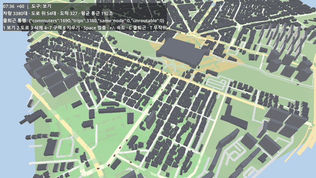

# sim_world — 우리 동네 AI 도시 시뮬레이터

실제 동네를 불러와 정책을 바꾸면 AI 시민이 어떻게 반응하는지 보는 오픈소스 도시 시뮬레이터입니다.
그래픽과 규모로 경쟁하지 않고, "우리 동네 + 정책 + AI 시민 반응" 하나에 집중합니다.
폭염·집중호우 같은 기후 변화 위험에 동네가 어떻게 적응하는지도 다룹니다.



<sub>평택역 원도심 1.5 km 사방, 출근 시간(07:36~, 60배속). 빨간 상자가 차량, 초록·주황은 주거·업무 구역. 지도 데이터 © OpenStreetMap contributors (ODbL), 지형 © Copernicus DEM</sub>

> **1단계 데모 단계**입니다. 실제 동네(평택역 원도심) 위에서 도로를 놓고·막고, 구역을 칠하면 출퇴근 차량이 움직입니다. 아직 정식 게임 빌드는 없고, 소스에서 실행합니다. **함께 만들 사람을 찾습니다** → [기여자 모집](docs/community/recruiting.md)

## 지금 되는 것

| 기능 | 어디 |
| --- | --- |
| OSM 도로·건물, Copernicus 지형, 토지 피복(불투수·녹지·수면)으로 동네 맵 패키지 만들기 | `gis/` → `maps/pyeongtaek-station` |
| 도로 그래프(노드 908·차선 2,588), 이벤트 기반 차선 대기열 교통, 결정론적 시뮬레이션 | `core/` (Rust) |
| 명령: 도로 추가·삭제, 구역 지정 → 경로 재계산 | `schema/commands`, `core/` |
| 구역 → 출퇴근 수요 (08시·18시 피크) | `core/crates/sim/src/demand.rs` |
| Python에서 `import dongne_core` 로 화면 없이 실험 | `core/crates/py`, `ai/experiments` |
| 시나리오 테스트: 도로를 막으면 평균 통근 시간이 늘어나는지 | `tests/scenarios` |
| Godot 4 화면: 지형·도로·건물, 차량 이동, 도로 그리기·삭제, 구역 칠하기 | `client/` |

## 실행해 보기

```sh
cd core && cargo test                                   # 코어 테스트 (Rust)
python tools/build_godot_addon.py                       # Godot 확장 빌드
godot --path client --import --headless && godot --path client   # 화면 (Godot 4.3+)
```

Python 바인딩과 실험: [core/crates/py/README.md](core/crates/py/README.md), [ai/experiments](ai/experiments/README.md). 조작법: [client/README.md](client/README.md).

## 구조

| 폴더 | 담당 | 내용 |
| --- | --- | --- |
| `docs/` | 리드/PM, 게임 디자인 | 비전, 로드맵, 설계 결정(ADR), 법적 규칙 |
| `schema/` | 전 팀 | 코어·클라이언트·AI 사이의 데이터 약속 |
| `core/` | 시뮬레이션 코어 | Rust. 틱 루프, 도로 그래프, 교통·경제·인구 |
| `gis/` | GIS | Python. OSM + Copernicus DEM → 맵 패키지 |
| `ai/` | AI 시뮬레이션 | Python. 페르소나, 보좌관, 화면 없는 실험 |
| `client/` | 클라이언트 | Godot 4. 화면과 UI |
| `art/` | 아트 | 절차 생성 규칙, 자체 제작 에셋 |
| `maps/` | GIS | 작은 샘플 맵 패키지 (ODbL) |
| `tests/scenarios/` | QA | 화면 없는 통합 시나리오 |
| `tools/` | 공용 | 빌드·데이터 내려받기 스크립트 |

전체 구조와 인터페이스는 [docs/architecture.md](docs/architecture.md)에 있습니다.

## 기여하기

기여 전에 [CONTRIBUTING.md](CONTRIBUTING.md)와 [클린룸 규칙](docs/legal/clean-room.md)을 꼭 읽어 주세요.
상용 게임의 코드·에셋 반입과 재배포가 허용되지 않는 지도 데이터 사용은 금지입니다.

## 라이선스와 출처

- 코드: [GPL-3.0-or-later](LICENSE)
- 아트 에셋·문서: CC BY-SA 4.0
- `maps/`의 지도 데이터: ODbL 1.0
- 데이터 출처 표기: [ATTRIBUTION.md](ATTRIBUTION.md)
