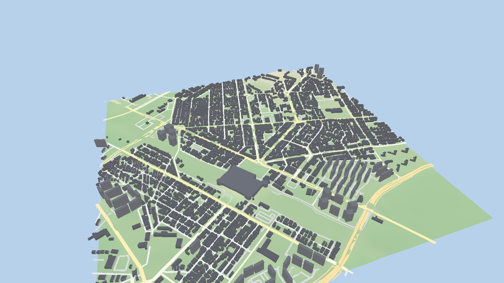

# client/ — Godot 4 클라이언트

화면과 UI를 맡습니다. 무거운 계산은 코어가 하고, 클라이언트는 결과를 그리고 입력을 명령으로 바꿉니다.

- Godot 4.3 이상 + GDScript (이 PC에서는 4.7.2로 확인)
- 코어는 GDExtension(`addons/dongne_core/`, 클래스 `DongneWorld`)으로 불러옵니다. 라이브러리 빌드물은 커밋하지 않습니다.

## 실행

```sh
python tools/build_godot_addon.py                 # core/crates/godot 빌드 → addons/dongne_core/bin/
godot --path client --import --headless           # 처음 한 번 (리소스 가져오기)
godot --path client                               # 맵 보기 창
godot --headless --path client -- --quit-after-load   # 화면 없이 씬 로드 확인 → "MAP_VIEW_OK …"
godot --path client -- --capture map.png          # 화면 캡처 저장 후 종료
godot --path client -- --map D:/other/map-package  # 다른 맵 패키지
```

## 맵 보기 (`scenes/map_view.tscn`, `scripts/map_view.gd`)

| 레이어 | 데이터 | 표시 |
| --- | --- | --- |
| 지형 | `terrain.png` + manifest 고도 범위 | 셀 중심을 꼭짓점으로 하는 격자 메시, 높이에 따라 색 |
| 도로 | 코어 도로 그래프 (`road_points`, 차선 수, 유형) | 차선 수 × 3 m 폭의 띠, 지형 위 0.6 m, 유형별 색 |
| 건물 | 코어가 읽은 `buildings.geojson` | 바닥 다각형을 표시 높이만큼 올린 상자 (지붕 삼각분할 + 벽) |

- 좌표: 맵 패키지 로컬 미터 (x 동쪽, y 북쪽) → Godot `(x, 높이, -y)`.
- 건물 높이는 OSM에 층수가 거의 없어 유형별 **가정** 높이를 씁니다 ([research-log.md](../docs/design/research-log.md#building-height)).
- Godot는 16비트 PNG를 8비트로 읽어서 지형 높이는 약 (최고−최저)/255 m 단위입니다 (평택역 맵 0.17 m). 표시에는 충분하고, 시뮬레이션은 코어가 원본을 씁니다.



캡처: 지도 데이터 © OpenStreetMap contributors (ODbL), 지형 © Copernicus DEM — [ATTRIBUTION.md](../ATTRIBUTION.md)
