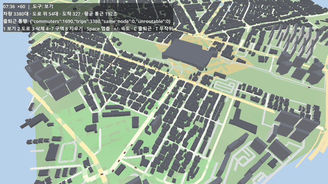

# 기여자 모집 글 (초안)

> 이 문서는 커뮤니티(Threads, 개발자 커뮤니티, 게임 개발 모임, 대학 동아리, 지역 커뮤니티 등)에 올릴 **초안**입니다. 올리는 곳과 시점은 관리자가 정합니다. GIF는 `docs/images/demo.gif`를 함께 붙입니다.

## 짧은 글 (Threads용, 500자 이내)

> GIF `docs/images/demo.gif`를 첨부합니다. 링크는 본문에 한 번만 넣습니다.

```text
우리 동네 지도를 불러와 도로 하나 막으면 출근길이 어떻게 바뀌는지 보는 오픈소스 도시 시뮬레이터를 만들고 있어요 🏙️

첫 동네는 평택역 원도심. 실제 지도 위에서 1,690명이 출퇴근하고, 많이 쓰는 도로 하나를 막으면 평균 통근이 4~16% 늘어요. 다음 목표는 폭염·침수와 정책 선택.

같이 만들 분을 찾아요 🙌
• Rust: 교통·인구·침수 모델
• Godot: 지도 레이어·UI
• 도시계획·교통·기후 전공: 수치 검토 (코드 몰라도 OK)

처음이면 good first issue부터, 질문은 Discussions에 편하게!
👉 github.com/Bongriyoundeng/sim_world
```

---

## 긴 글 (게시판·블로그용)

## "우리 동네를 불러와 정책을 바꿔 보는" 오픈소스 도시 시뮬레이터, 함께 만들 사람을 찾습니다



**sim_world**는 실제 동네 지도를 불러와 도로·구역·정책을 바꾸면 AI 시민이 어떻게 반응하는지 보는 오픈소스 도시 시뮬레이터입니다. 큰 도시를 화려하게 그리는 대신 "**우리 동네 + 정책 + 시민 반응**"에 집중하고, 폭염·집중호우 같은 기후 위험에 동네가 어떻게 적응하는지도 다룹니다.

첫 동네는 **평택역 원도심(통복천 일대)** 입니다. 실제로 통복천 범람 우려로 주민이 대피한 적이 있고, 원도심 재개발과 신도시 사이의 갈등이 있는 곳이라 "정답 없는 선택"을 보여 주기 좋습니다.

### 지금까지 된 것

1단계 데모:

- OpenStreetMap 도로·건물 + Copernicus 지형 + 토지 피복으로 동네 맵 만들기
- Rust 코어: 도로 그래프, 이벤트 기반 차선 대기열 교통, 같은 입력이면 같은 결과(결정론)
- 도로 놓기·막기, 주거·상업·업무·공원 구역 칠하기 → 출퇴근 차량이 경로를 바꿈
- 출퇴근 1,690명 시나리오: 많이 쓰이는 도로 하나를 막으면 평균 통근 +4~16%
- Python에서 `import dongne_core`로 화면 없이 실험, Godot 4 화면

2단계 진행 중 ([작업 목록](../design/phase2-backlog.md)):

- 시간 모델(틱 100 ms, 하루·계절)과 계절 진행 API
- 결정론 검사: 상태 해시를 Windows·Linux CI에서 비교
- 교차로 신호·차로별 처리량, 혼잡을 반영한 경로
- 다음: 인구·경제, 폭염·내수 침수 격자, 기후 정책, AI 보좌관 브리핑

### 이런 분을 찾습니다

| 분야 | 하는 일 (예) |
| --- | --- |
| Rust (시뮬레이션 코어) | 인구·경제, 폭염·침수 격자 |
| Godot / GDScript (클라이언트) | UI, 지도 레이어(교통·열·침수), 연출 |
| Python / GIS | 다른 동네 맵 패키지, 통계 자료로 밸런스 보정 |
| AI / LLM | 시민 페르소나, 보좌관 브리핑, 헤드리스 실험 |
| 게임·정책 기획 | 정책 카드, 기후 시나리오, 밸런스 (`docs/design/`) |
| 아트 | 절차 생성 규칙, 자체 제작 에셋 |
| 도시계획·교통·기후 전공 | 모델과 수치가 현실과 맞는지 검토 — 코드를 몰라도 큰 도움이 됩니다 |

### 약속

- 코드 GPL-3.0, 에셋·문서 CC BY-SA 4.0, 지도 데이터 ODbL. 모든 수치에는 근거나 "가정" 표시를 남깁니다 (`docs/design/research-log.md`).
- **클린룸 규칙**: 상용 게임의 코드·에셋·리버스 엔지니어링 결과, 재배포가 허용되지 않는 지도(구글·카카오·네이버 등)는 쓰지 않습니다.
- 커밋에 DCO 서명(`git commit -s`)을 합니다.

### 시작하기

1. 저장소: https://github.com/Bongriyoundeng/sim_world
2. [README](../../README.md)의 "실행해 보기"와 [CONTRIBUTING.md](../../CONTRIBUTING.md), [클린룸 규칙](../legal/clean-room.md)을 읽어 주세요.
3. 첫 기여로 좋은 일: [`good first issue` 라벨이 붙은 이슈](https://github.com/Bongriyoundeng/sim_world/issues?q=is%3Aissue+is%3Aopen+label%3A%22good+first+issue%22), [balance.md](../design/balance.md)의 "다음에 확인할 것"(통계로 가정값 교체), 다른 동네 맵 패키지 만들기, Godot UI 다듬기.

질문·아이디어·자기소개는 [GitHub Discussions](https://github.com/Bongriyoundeng/sim_world/discussions)에, 버그와 구체적인 작업은 이슈로 남겨 주세요.
